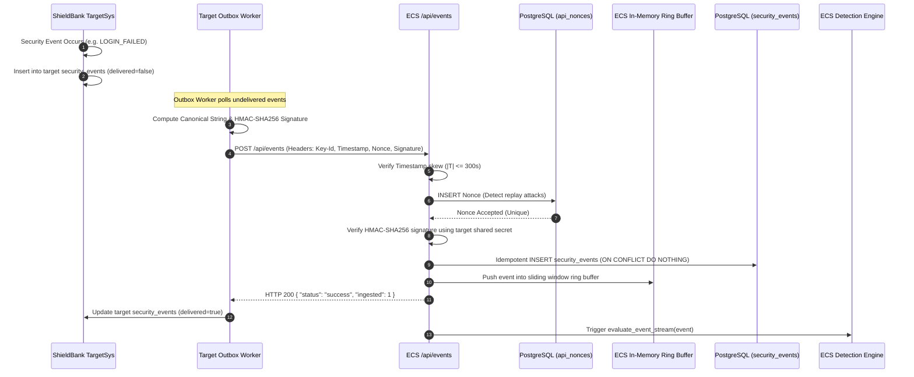
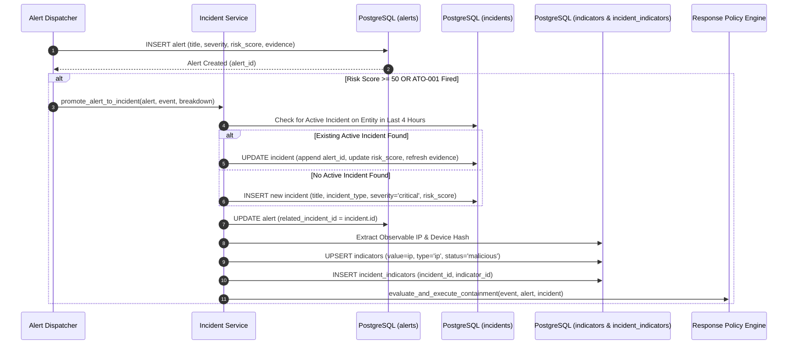
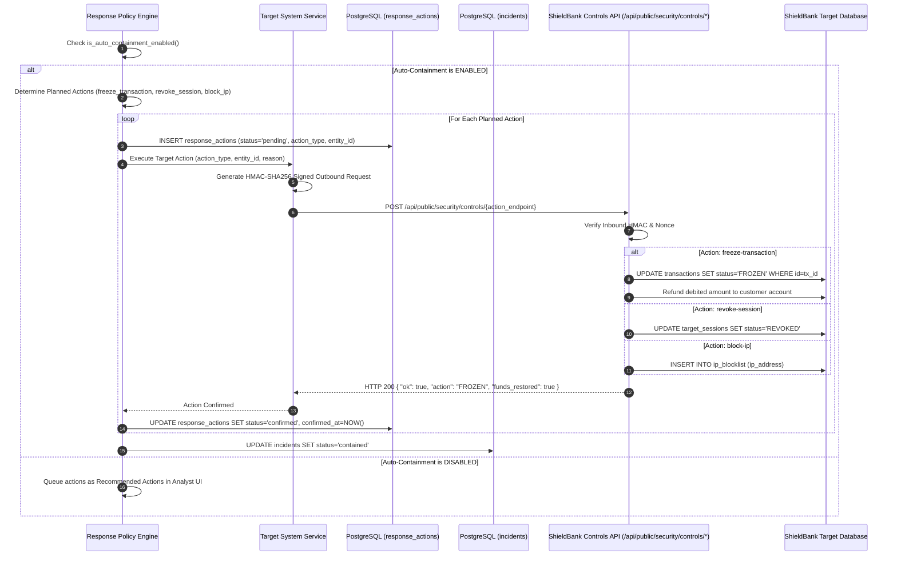
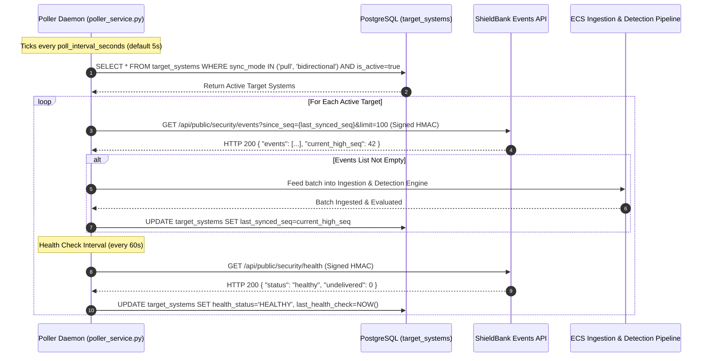
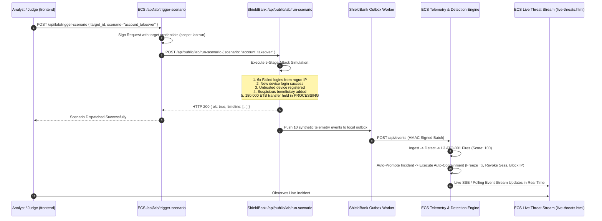
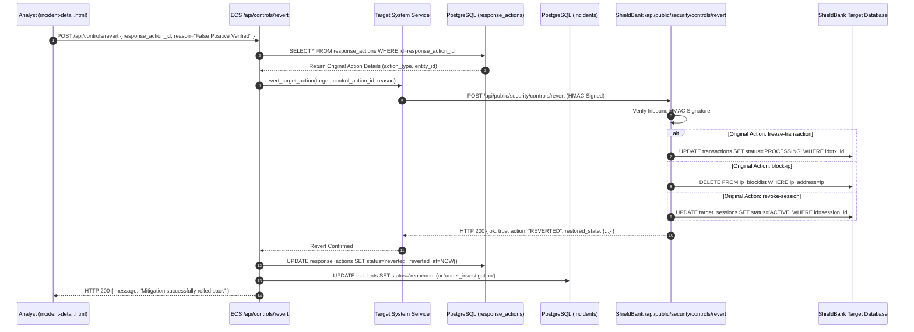

# Ethio-Cyber-Shield (ECS) & Target System (ShieldBank): Complete System Architecture, Features, and End-to-End Flows

> **Document Type**: Master Technical Architecture, Feature Catalog & Interaction Specification  
> **Status**: Complete & Verified (v2.0 Automated Closed-Loop Cyber Defense Platform)  
> **Target System Reference**: ShieldBank Synthetic Banking Testbed (`targetsys`)  
> **Central Defense Platform Reference**: Ethio-Cyber-Shield Core (`Ethio-Cyber-Shield`)

---

## Table of Contents
1. [Executive Architecture & Ecosystem Overview](#1-executive-architecture--ecosystem-overview)
2. [Target System Interconnection & Integration Contracts](#2-target-system-interconnection--integration-contracts)
   - [2.1 Dual Ingestion Protocols (Direction A Push & Direction B Pull)](#21-dual-ingestion-protocols)
   - [2.2 Canonical HMAC-SHA256 Cryptographic Authentication](#22-canonical-hmac-sha256-cryptographic-authentication)
   - [2.3 Nonce Replay Attack Defense & State Tracking](#23-nonce-replay-attack-defense--state-tracking)
   - [2.4 Bidirectional Health Checks & Liveness Monitoring](#24-bidirectional-health-checks--liveness-monitoring)
3. [Exhaustive ECS Feature Catalog](#3-exhaustive-ecs-feature-catalog)
   - [Core Platform & Engine Features (Features 1 – 14)](#core-platform--engine-features)
   - [SOC Analyst & Operations Features (Features 15 – 21)](#soc-analyst--operations-features)
4. [Step-by-Step System Execution Flows](#4-step-by-step-system-execution-flows)
   - [Flow 1: Telemetry Generation & Signed Outbox Ingestion](#flow-1-telemetry-generation--signed-outbox-ingestion)
   - [Flow 2: Multi-Layer Detection & Explainable Risk Scoring](#flow-2-multi-layer-detection--explainable-risk-scoring)
   - [Flow 3: Autonomous Alerting & Incident Promotion](#flow-3-autonomous-alerting--incident-promotion)
   - [Flow 4: Closed-Loop Containment & Mitigation Dispatch](#flow-4-closed-loop-containment--mitigation-dispatch)
   - [Flow 5: Background Polling Synchronization](#flow-5-background-polling-synchronization)
   - [Flow 6: Remote Attack Lab Orchestration](#flow-6-remote-attack-lab-orchestration)
   - [Flow 7: Containment Rollback & Revert Execution](#flow-7-containment-rollback--revert-execution)
5. [Database Schema & Entity Relationship Model](#5-database-schema--entity-relationship-model)

---

## 1. Executive Architecture & Ecosystem Overview

Ethio-Cyber-Shield (ECS) is a real-time cybersecurity operations, threat intelligence, and automated incident response platform. Rather than relying on human analysts to manually record security events, ECS is architected as an **independent defense controller** that connects to any target application (in this deployment, the **ShieldBank synthetic banking testbed**) to continuously ingest telemetry, evaluate multi-event attack chains, synthesize explainable risk scores (0–100), and autonomously dispatch containment commands.

```
┌─────────────────────────────────────────────────────────────────────────────────────────────────┐
│                                SHIELDBANK TARGET SYSTEM (targetsys)                             │
│                                                                                                 │
│  ┌──────────────────────┐   ┌──────────────────────┐   ┌─────────────────────────────────────┐  │
│  │   Customer Portal    │   │      Admin Shell     │   │         Remote Attack Lab           │  │
│  │   (/app routes)      │   │   (/admin routes)    │   │  (/admin/lab - Scenarios 1-4)       │  │
│  └──────────┬───────────┘   └──────────┬───────────┘   └──────────────────┬──────────────────┘  │
│             │                          │                                  │                     │
│             └──────────────────────────┼──────────────────────────────────┘                     │
│                                        ▼                                                        │
│                         ┌───────────────────────────────┐                                       │
│                         │   Telemetry Outbox Collector  │                                       │
│                         │   - Canonical Event v1.0      │                                       │
│                         │   - Signed HMAC Delivery      │                                       │
│                         └──────────────┬────────────────┘                                       │
└────────────────────────────────────────┼────────────────────────────────────────────────────────┘
                                         │
                 Direction A: Push       │           Direction B: Controls & Health
                 Signed Telemetry Batch  │           HMAC Mitigation Commands
                 (POST /api/events)      │           (freeze, revoke, block, revert)
                                         ▼                                 ▲
┌──────────────────────────────────────────────────────────────────────────┼──────────────────────┐
│                                 ETHIO-CYBER-SHIELD (ECS) CORE ENGINE     │                      │
│                                                                          │                      │
│   ┌────────────────────────────────┐            ┌────────────────────────┴──────────────────┐   │
│   │   Ingestion & Verification     │            │      Closed-Loop Controlled Response      │   │
│   │   - HMAC-SHA256 Verification   │            │      - Policy Gatekeeper (Auto/Manual)    │   │
│   │   - Anti-Replay Nonce DB Cache │            │      - Idempotent Target Command Sender   │   │
│   │   - Sliding Window Buffer      │            │      - State Verification & Rollback      │   │
│   └───────────────┬────────────────┘            └────────────────────────▲──────────────────┘   │
│                   │                                                      │                      │
│                   ▼                                                      │                      │
│   ┌────────────────────────────────┐            ┌────────────────────────┴──────────────────┐   │
│   │   Multi-Layer Detection Engine │            │      Autonomous Incident Promotion        │   │
│   │   - L1: Threshold Signatures   │            │      - Critical / High Auto-Promotion     │   │
│   │   - L2: Contextual Entities    │ ─────────> │      - 4-Hour Entity Deduplication        │   │
│   │   - L3: Attack Chain (ATO-001) │            │      - IOC Indicator Extraction           │   │
│   │   - L4: Explainable Risk (0-100)│           │      - Attack Graph Reconstruction        │   │
│   └────────────────────────────────┘            └───────────────────────────────────────────┘   │
│                                                                          │                      │
│                   ┌──────────────────────────────────────────────────────┴──────────────────┐   │
│                   │                Persistent PostgreSQL Database (Supabase)                │   │
│                   │  security_events • detections • alerts • incidents • response_actions   │   │
│                   └─────────────────────────────────────────────────────────────────────────┘   │
└─────────────────────────────────────────────────────────────────────────────────────────────────┘
                                         │
                                         ▼
┌─────────────────────────────────────────────────────────────────────────────────────────────────┐
│                                   MODERNIZED SOC INTERFACE (frontend)                           │
│  Live Threat Stream • Incident Command • Forensics Scrubbing • Target Registry • Audit Log      │
└─────────────────────────────────────────────────────────────────────────────────────────────────┘
```

---

## 2. Target System Interconnection & Integration Contracts

The connection between `targetsys` and `Ethio-Cyber-Shield` operates over an authenticated, bidirectional HTTP interface conforming strictly to the **ECS Telemetry & Control Contract v1.0**.

### 2.1 Dual Ingestion Protocols
ECS supports two complementary ingestion modes:

1. **Direction A (Push / Webhook)**:
   - Target System’s background outbox worker (`outbox.server.ts`) batches un-delivered events and pushes them to ECS:
     ```http
     POST http://127.0.0.1:5000/api/events
     ```
   - Target System calculates HMAC headers using the shared `secret_key`.
   - ECS processes the batch immediately and returns HTTP 200 with the count of ingested events.

2. **Direction B (Pull / Outbound Synchronization Poller)**:
   - For targets running behind strict firewalls that cannot initiate outbound traffic, ECS runs a background daemon (`poller_service.py`).
   - The poller queries the target's public export endpoint:
     ```http
     GET http://127.0.0.1:8081/api/public/security/events?since_seq={last_synced_seq}&limit=100
     ```
   - Target System returns ordered events. ECS ingests the batch and updates the target's `last_synced_seq` high-water mark.

---

### 2.2 Canonical HMAC-SHA256 Cryptographic Authentication
Every cross-boundary API request (telemetry push, poller pull, or mitigation command) must contain four canonical HTTP headers:

| Header Name | Purpose | Specification |
| :--- | :--- | :--- |
| `X-ECS-Key-Id` | Public Credential Identifier | String identifying the target integration (e.g. `ecs_live_prod_key_01`) |
| `X-ECS-Timestamp` | Replay Window Guard | Unix timestamp in seconds (integer string). Validated within $\pm 300\text{ seconds}$ |
| `X-ECS-Nonce` | Uniqueness Token | Cryptographic UUIDv4 string. Must never be reused within the TTL window |
| `X-ECS-Signature` | Cryptographic Proof | Lowercase hex HMAC-SHA256 signature calculated over the Canonical Payload |

#### Canonical String Construction:
$$\text{CanonicalString} = \text{Timestamp} + \text{"\textbackslash n"} + \text{Nonce} + \text{"\textbackslash n"} + \text{Method.toUpperCase()} + \text{"\textbackslash n"} + \text{PathWithQuery} + \text{"\textbackslash n"} + \text{SHA256}(\text{RawBody})$$

```python
# ECS Python Verification Implementation:
import hmac, hashlib

body_sha256 = hashlib.sha256(raw_body.encode('utf-8')).hexdigest()
canonical = f"{timestamp}\n{nonce}\n{method.upper()}\n{path_with_query}\n{body_sha256}"
expected_sig = hmac.new(secret_key.encode('utf-8'), canonical.encode('utf-8'), hashlib.sha256).hexdigest()

if not hmac.compare_digest(provided_sig, expected_sig):
    raise AuthError("Invalid HMAC Signature")
```

---

### 2.3 Nonce Replay Attack Defense & State Tracking
To eliminate replay attacks:
1. Every received nonce is verified against the `api_nonces` table in PostgreSQL.
2. If `nonce` already exists for that `key_id`, ECS rejects the request with HTTP 401: `Replay attack detected: Nonce already used`.
3. Nonces are inserted with an `expires_at` timestamp set to $\text{now} + 10\text{ minutes}$. An automated TTL index purges expired nonces.

---

### 2.4 Bidirectional Health Checks & Liveness Monitoring
ECS monitors target systems via periodic heartbeats:
- **Target Endpoint**: `GET /api/public/security/health`
- **Request**: Signed with ECS client credentials.
- **Response**:
  ```json
  {
    "status": "healthy",
    "service": "ShieldBank Testbed",
    "delivery_enabled": true,
    "undelivered_events": 0,
    "active_blocked_ips": 1,
    "active_frozen_transactions": 2,
    "system_time": "2026-10-16T22:30:00.000Z"
  }
  ```
- **ECS Database Update**: Updates `target_systems.health_status` (`HEALTHY`, `DEGRADED`, `UNREACHABLE`) and `target_systems.last_health_check`.

---

## 3. Exhaustive ECS Feature Catalog

### Core Platform & Engine Features

#### Feature 1: Universal Telemetry Ingestion & In-Memory Ring Buffer
- **File**: [`backend/app/routes/events.py`](file:///home/neuron/dev/cybershield/Ethio-Cyber-Shield/backend/app/routes/events.py), [`backend/app/services/event_service.py`](file:///home/neuron/dev/cybershield/Ethio-Cyber-Shield/backend/app/services/event_service.py)
- **Description**: Accepts batches of up to 100 events in Canonical Envelope v1.0 format. Validates required fields (`event_id`, `event_type`, `occurred_at`, `source_system`, `result`). Idempotently inserts records into `security_events` table (ignoring duplicates by unique `event_id`). In parallel, writes events into an in-memory sliding ring-buffer (capacity 5,000 events) for sub-millisecond detection evaluation without hitting database disk I/O.
- **Affected Tables**: `security_events`, `transactions`, `indicators`.

#### Feature 2: Anti-Replay Nonce Verification Gateway
- **File**: [`backend/app/routes/events.py`](file:///home/neuron/dev/cybershield/Ethio-Cyber-Shield/backend/app/routes/events.py#L38-L80)
- **Description**: Cryptographically verifies incoming HTTP requests. Enforces a strict $\pm 300\text{s}$ timestamp window and verifies uniqueness in `api_nonces`.

#### Feature 3: Outbound Synchronization Poller Daemon
- **File**: [`backend/app/services/poller_service.py`](file:///home/neuron/dev/cybershield/Ethio-Cyber-Shield/backend/app/services/poller_service.py)
- **Description**: Background threading daemon that periodically scans `target_systems` where `sync_mode` is `pull` or `bidirectional`. Dispatches signed `GET /api/public/security/events?since_seq={last_synced_seq}` calls, streams responses through the detection engine, and advances the target's `last_synced_seq`.

#### Feature 4: Layer 1 (L1) Threshold & Signature Rules
- **File**: [`backend/app/services/detection_engine.py`](file:///home/neuron/dev/cybershield/Ethio-Cyber-Shield/backend/app/services/detection_engine.py#L174-L255)
- **Rules**:
  - `AUTH-001 (Login Failure Burst)`: Detects $\ge 5$ failed login attempts for the same account within a 60-second sliding window. Contribution: $+25$ points. Severity: `medium`.
  - `AUTH-002 (Multi-Account Credential Stuffing Burst)`: Detects a single IP targeting $\ge 3$ distinct accounts with failed logins within 60 seconds. Contribution: $+35$ points. Severity: `high`.
  - `TX-001 (High-Value Transfer Anomaly)`: Detects transfers with amount $\ge 100,000\text{ ETB}$. Contribution: $+20$ points. Severity: `medium`.
  - `IOC-001 (Malicious Source IP Match)`: Matches client IP against known threat indicators or active watchlists. Contribution: $+40$ points. Severity: `high`.
  - `API-001 (Authorization Denial Burst)`: Detects $\ge 4$ `AUTHZ_DENIED` or `RATE_LIMITED` events from the same source IP/session within 60 seconds. Contribution: $+25$ points. Severity: `medium`.

#### Feature 5: Layer 2 (L2) Contextual Entity Rules
- **File**: [`backend/app/services/detection_engine.py`](file:///home/neuron/dev/cybershield/Ethio-Cyber-Shield/backend/app/services/detection_engine.py#L256-L332)
- **Rules**:
  - `AUTH-003 (New Device Login After Suspicious Failures)`: Triggers when `LOGIN_SUCCESS` occurs on an unrecognized/new hardware device within 5 minutes of $\ge 3$ failed login attempts on that account. Contribution: $+35$ points. Severity: `high`.
  - `TX-003 (Off-Hours High-Value Transfer)`: Triggers when a transfer $\ge 100,000\text{ ETB}$ occurs between 00:00 and 05:00 Addis Ababa local time (UTC+3). Contribution: $+25$ points. Severity: `high`.
  - `TX-004 (Untrusted / First-Time Device Transfer)`: Triggers when a transfer is initiated from a device flagged as untrusted (`device_trusted: false`). Contribution: $+25$ points. Severity: `high`.
  - `PRIV-001 (Unauthorized Privilege Abuse Attempt)`: Detects customer accounts attempting administrative endpoints (`/admin`, `/api/admin`) or operations. Contribution: $+40$ points. Severity: `high`.
  - `API-002 (Sequential Resource Enumeration Probing)`: Detects rapid sequential probing of numeric resource identifiers (IDOR patterns) within 60 seconds. Contribution: $+35$ points. Severity: `high`.

#### Feature 6: Layer 3 (L3) Multi-Event Attack Chain Correlation Engine
- **File**: [`backend/app/services/detection_engine.py`](file:///home/neuron/dev/cybershield/Ethio-Cyber-Shield/backend/app/services/detection_engine.py#L333-L388)
- **Description**: Reconstructs stateful multi-event kill chains across a 15-minute sliding window per entity.
- **Primary Signature: `ATO-001 (Account Takeover Chain)`**:
  - **Attack Sequence Evaluated**:
    $$\text{LOGIN\_FAILED} (\ge 3\text{x}) \longrightarrow \text{LOGIN\_SUCCESS (New Device)} \longrightarrow \text{DEVICE\_REGISTERED} \longrightarrow \text{BENEFICIARY\_CREATED} \longrightarrow \text{TRANSFER\_CREATED (Held in Processing)}$$
  - **Contribution**: $+80$ points.
  - **Severity**: `critical`.
  - **Evidence Generated**: Reconstructed multi-stage kill-chain log with exact timestamps, device IDs, and monetary values.

#### Feature 7: Layer 4 (L4) Explainable Risk Synthesis & Scoring
- **File**: [`backend/app/services/detection_engine.py`](file:///home/neuron/dev/cybershield/Ethio-Cyber-Shield/backend/app/services/detection_engine.py#L390-L420)
- **Mathematical Model**:
  $$\text{RawScore} = \sum_{\text{fired}} \text{RuleWeight}$$
  $$\text{CappedRiskScore} = \min(100, \text{RawScore})$$
- **Severity Classification**:
  - $0 - 24$: `low`
  - $25 - 49$: `medium`
  - $50 - 74$: `high`
  - $75 - 100$: `critical`
- **Output**: Persists individual rule firings to `detections` and full explainability breakdown (`breakdown`, `reasons`, `trigger_event_ids`) to `risk_assessments`.

#### Feature 8: Autonomous Alert Dispatcher
- **File**: [`backend/app/services/detection_engine.py`](file:///home/neuron/dev/cybershield/Ethio-Cyber-Shield/backend/app/services/detection_engine.py#L496-L551)
- **Description**: Whenever calculated risk score is $\ge 25$, automatically generates an alert row in `alerts`. Attaches itemized evidence JSON, primary rule name, triggering event IDs, affected account, and source IP.

#### Feature 9: Autonomous Incident Promotion & Entity Deduplication
- **File**: [`backend/app/services/incident_service.py`](file:///home/neuron/dev/cybershield/Ethio-Cyber-Shield/backend/app/services/incident_service.py#L22-L130)
- **Description**: Evaluates alerts with score $\ge 50$ or `ATO-001`.
  - Checks if an active incident for the affected entity (`account` or `user`) already exists within the last **4 hours**.
  - **If Exists**: Appends the new alert and events to the existing incident; recalculates the cumulative incident risk score.
  - **If Not Exists**: Creates a new incident in `incidents` with status `open`, risk score, and rule breakdown. Automatically updates the alert row with `related_incident_id`.

#### Feature 10: Automated Threat Intelligence & Indicator Linking
- **File**: [`backend/app/services/incident_service.py`](file:///home/neuron/dev/cybershield/Ethio-Cyber-Shield/backend/app/services/incident_service.py#L132-L190)
- **Description**: Automatically harvests observable IP addresses and device fingerprint hashes from triggering events. Upserts them into `indicators` table with status `malicious` (for critical/ATO chains) or `suspicious`. Links indicators to the incident via `incident_indicators`.

#### Feature 11: Dynamic Watchlist Monitoring & Cross-Referencing
- **File**: [`backend/app/services/detection_engine.py`](file:///home/neuron/dev/cybershield/Ethio-Cyber-Shield/backend/app/services/detection_engine.py#L101-L123), [`backend/app/routes/watchlists.py`](file:///home/neuron/dev/cybershield/Ethio-Cyber-Shield/backend/app/routes/watchlists.py)
- **Description**: Maintains a registry of monitored accounts, IPs, and national IDs. Every ingested event is cross-referenced against active watchlists; any match adds $+40$ risk points and flags the alert as watchlist-correlated.

#### Feature 12: Closed-Loop Controlled Response Engine
- **File**: [`backend/app/services/response_policy.py`](file:///home/neuron/dev/cybershield/Ethio-Cyber-Shield/backend/app/services/response_policy.py)
- **Description**: Evaluates incident severity against system mitigation policies.
  - Checks master switch `system_settings.auto_containment`.
  - If **ENABLED**: Dispatches authenticated HTTP containment commands to the target application to neutralize the threat.
  - If **DISABLED**: Queues actions as "Recommended Containment Actions" in the analyst UI for 1-click manual execution.

#### Feature 13: Target Mitigation Operations
- **File**: [`backend/app/services/target_system_service.py`](file:///home/neuron/dev/cybershield/Ethio-Cyber-Shield/backend/app/services/target_system_service.py)
- **Supported Operations**:
  1. `freeze_target_transaction`: Calls `POST /api/public/security/controls/freeze-transaction` with `transaction_id`. Sets transaction status to `FROZEN` and returns funds to customer.
  2. `revoke_target_session`: Calls `POST /api/public/security/controls/revoke-session` with `session_public_id`. Sets session status to `REVOKED`.
  3. `block_target_ip`: Calls `POST /api/public/security/controls/block-ip` with `ip_address`. Adds IP to target's active blocklist.
  4. `require_step_up`: Calls `POST /api/public/security/controls/require-step-up` with `user_id`. Forces mandatory OTP on next action.
  5. `disable_beneficiary`: Calls `POST /api/public/security/controls/disable-beneficiary`. Flags beneficiary as disabled.
  6. `lock_account`: Calls `POST /api/public/security/controls/lock-account`. Prevents all debits on account.
  7. `revert_target_action`: Calls `POST /api/public/security/controls/revert`. Rolls back a previously executed mitigation.
- **Audit & State Tracking**: Every action creates a row in `response_actions` (`pending` $\rightarrow$ `confirmed` $\rightarrow$ `reverted`).

#### Feature 14: Target System Attack Lab Orchestrator
- **File**: [`backend/app/routes/live.py`](file:///home/neuron/dev/cybershield/Ethio-Cyber-Shield/backend/app/routes/live.py#L320-L400)
- **Description**: Endpoint `POST /api/lab/trigger-scenario` allows analysts to remotely command the target system to execute attack simulations (`account_takeover`, `credential_stuffing`, `privilege_abuse`, `api_abuse`). The target executes synthetic attacks, pushing live telemetry back to ECS to prove detection effectiveness.

---

### SOC Analyst & Operations Features

#### Feature 15: SOC Live Threat Feed & Event Streaming
- **File**: [`frontend/live-threats.html`](file:///home/neuron/dev/cybershield/Ethio-Cyber-Shield/frontend/live-threats.html), [`backend/app/routes/live.py`](file:///home/neuron/dev/cybershield/Ethio-Cyber-Shield/backend/app/routes/live.py)
- **Description**: Real-time polling feed showing incoming `security_events` with color-coded severity badges, source IP, event type, and risk score. Includes quick-filter chips (All, Auth, Transactions, Admin, Denied).

#### Feature 16: Interactive Incident Command & Forensic Kill-Chain Visualizer
- **File**: [`frontend/incident-detail.html`](file:///home/neuron/dev/cybershield/Ethio-Cyber-Shield/frontend/incident-detail.html)
- **Description**: Deep investigation view for any incident:
  - **Kill-Chain Timeline**: Horizontal visual diagram showing each step of the attack.
  - **Risk Score Breakdown**: Visual progress bar (0–100) displaying rule weights and evidence tags.
  - **Containment Control Station**: Shows status of all automated actions (`FROZEN`, `REVOKED`) with a 1-click **"Rollback Action"** button.
  - **Forensic Evidence Log**: Raw event payloads and cryptographic signatures.

#### Feature 17: Forensic Replay & Investigation Scrubbing Station
- **File**: [`frontend/reports.html`](file:///home/neuron/dev/cybershield/Ethio-Cyber-Shield/frontend/reports.html)
- **Description**: Allows analysts and auditors to scrub through historical incidents step-by-step, replaying event timestamps to observe exact detection timelines.

#### Feature 18: Target Systems Registry & Posture Management
- **File**: [`backend/app/routes/targets.py`](file:///home/neuron/dev/cybershield/Ethio-Cyber-Shield/backend/app/routes/targets.py), [`frontend/settings.html`](file:///home/neuron/dev/cybershield/Ethio-Cyber-Shield/frontend/settings.html)
- **Description**: Admin interface to register new target nodes, configure shared secrets, set polling intervals, test connection liveness, and toggle the master auto-containment switch.

#### Feature 19: Immutable Audit Logging & Forensic Traceability
- **File**: [`backend/app/services/audit_service.py`](file:///home/neuron/dev/cybershield/Ethio-Cyber-Shield/backend/app/services/audit_service.py), [`frontend/audit.html`](file:///home/neuron/dev/cybershield/Ethio-Cyber-Shield/frontend/audit.html)
- **Description**: Every administrative action, rule trigger, login attempt, containment command, and configuration change is written to `audit_logs` with actor ID, IP address, timestamp, and metadata diffs.

#### Feature 20: Role-Based Access Control (RBAC) & Session Management
- **File**: [`backend/app/services/auth_service.py`](file:///home/neuron/dev/cybershield/Ethio-Cyber-Shield/backend/app/services/auth_service.py), [`backend/app/routes/auth.py`](file:///home/neuron/dev/cybershield/Ethio-Cyber-Shield/backend/app/routes/auth.py)
- **Description**: Enforces JWT bearer token authentication with role-based permissions (`admin`, `analyst`, `viewer`). Password hashing via bcrypt (12 rounds).

#### Feature 21: Regulatory Compliance & Incident Reporting (Proclamation No. 1426/2026)
- **File**: [`backend/app/routes/reports.py`](file:///home/neuron/dev/cybershield/Ethio-Cyber-Shield/backend/app/routes/reports.py)
- **Description**: Generates standardized incident disclosure summaries compliant with Ethiopia's Critical Infrastructure Cybersecurity Protection Proclamation No. 1426/2026 (mandating 48-hour incident reporting to the National CERT).

---

## 4. Step-by-Step System Execution Flows

### Flow 1: Telemetry Generation & Signed Outbox Ingestion



1. An action occurs on ShieldBank (e.g., user attempts login with bad password).
2. The banking backend writes a row into its local `security_events` table with `delivered = false`.
3. The background outbox worker (`outbox.server.ts`) picks up the record.
4. Generates a UUIDv4 nonce, current timestamp, builds the canonical string, and signs it using HMAC-SHA256.
5. Sends an HTTP POST to `http://127.0.0.1:5000/api/events`.
6. ECS validates timestamp freshness ($\le 300\text{s}$) and checks the `api_nonces` table.
7. ECS computes the expected HMAC signature and compares it in constant time (`hmac.compare_digest`).
8. The event is persisted to `security_events` and queued into the in-memory ring buffer.
9. ECS returns HTTP 200. Target marks the event as `delivered = true`.
10. ECS immediately forwards the event to `evaluate_event_stream`.

---

### Flow 2: Multi-Layer Detection & Explainable Risk Scoring

```mermaid
sequenceDiagram
    autonumber
    participant Engine as Detection Engine
    participant Buffer as Sliding Window Buffer
    participant Rules as Rule Evaluator (L1 - L3)
    participant Scorer as L4 Risk Scorer (0-100)
    participant DetDB as PostgreSQL (detections / risk_assessments)
    participant AlertEng as Alert Dispatcher

    Engine->>Buffer: Query Sliding Window Events (Account, IP, Device, Time)
    Buffer-->>Engine: Return Matching Events in [Now - 900s, Now]
    
    Engine->>Rules: Evaluate Layer 1 Thresholds (AUTH-001, AUTH-002, TX-001, IOC-001, API-001)
    Engine->>Rules: Evaluate Layer 2 Context (AUTH-003, TX-003, TX-004, PRIV-001)
    Engine->>Rules: Evaluate Layer 3 Correlation (ATO-001 Account Takeover Chain)
    
    Rules-->>Scorer: Return Fired Rules List with Individual Weights
    Scorer->>Scorer: RawScore = Sum(Weights); CappedScore = Min(100, RawScore)
    Scorer->>Scorer: Classify Severity: Low (<25), Medium (25-49), High (50-74), Critical (75+)
    Scorer->>Scorer: Compile Itemized Evidence Breakdown & Explanations
    
    Scorer->>DetDB: INSERT individual detections (rule_id, score_contrib, evidence)
    Scorer->>DetDB: INSERT risk_assessments (risk_score, severity, breakdown)
    
    alt CappedScore >= 25
        Scorer->>AlertEng: Trigger Alert Generation (Score, Severity, Breakdown)
    end
```

1. `evaluate_event_stream` receives the event and extracts identifiers (`account_id`, `source_ip`, `device_id`).
2. Fetches matching recent events from the in-memory buffer across sliding windows (60s, 300s, 900s).
3. Evaluates **Layer 1**: checks for login failure bursts ($\ge 5$), credential stuffing ($\ge 3$ accounts), high-value transfers ($\ge 100\text{k ETB}$), and authorization bursts ($\ge 4$).
4. Evaluates **Layer 2**: checks if login success followed recent failures from a new device (`AUTH-003`), off-hours timing (`TX-003`), untrusted device usage (`TX-004`), or admin privilege abuse (`PRIV-001`).
5. Evaluates **Layer 3**: tests for the complete **Account Takeover Chain (`ATO-001`)**:
   $$\text{Failures} \rightarrow \text{Success (New Device)} \rightarrow \text{Beneficiary} \rightarrow \text{Held High-Value Transfer}$$
6. Evaluates **Layer 4**: computes $\text{CappedScore} = \min(100, \sum \text{Weights})$. Compiles explainability breakdown.
7. Persists records to `detections` and `risk_assessments`.
8. If score $\ge 25$, initiates alert generation.

---

### Flow 3: Autonomous Alerting & Incident Promotion



1. Alert Dispatcher inserts an alert row into `alerts` with the calculated severity and evidence breakdown.
2. If risk score is $\ge 50$ or `ATO-001` fired, `promote_alert_to_incident` executes.
3. Queries `incidents` for an existing open incident on that entity (`account` or `user`) within a 4-hour window:
   - **Found**: Merges the alert and events into the existing incident, updating its risk score and kill chain.
   - **Not Found**: Inserts a new incident with title e.g. `"Investigate: Account Takeover on ACC_AMINA_1"`.
4. Links the alert to the incident via `related_incident_id`.
5. Extracts threat observables (source IP, device fingerprint hash) and upserts them into `indicators`.
6. Inserts join records into `incident_indicators`.
7. Forwards incident and alert context to the Closed-Loop Response Policy Engine.

---

### Flow 4: Closed-Loop Containment & Mitigation Dispatch



1. `evaluate_and_execute_containment` checks `system_settings.auto_containment`.
2. Evaluates the incident rules:
   - If `ATO-001`: Plans **freeze_transaction** on the held transfer + **revoke_session** on the attacker session + **block_ip** on the attacker's IP.
   - If `TX` Anomaly: Plans **freeze_transaction**.
   - If Credential Stuffing / `AUTH-002`: Plans **block_ip**.
3. For each planned action, inserts a `response_actions` row with `status = 'pending'`.
4. `target_system_service.py` builds an HMAC-SHA256 signed POST request to the corresponding target endpoint:
   - `POST /api/public/security/controls/freeze-transaction`
   - `POST /api/public/security/controls/revoke-session`
   - `POST /api/public/security/controls/block-ip`
5. ShieldBank validates the signature, executes the mitigation:
   - Transaction status transitions to `FROZEN`; funds are restored to customer balance.
   - Attacker session transitions to `REVOKED`.
   - Attacker IP is inserted into `ip_blocklist`.
6. ShieldBank returns HTTP 200 with confirmation details.
7. ECS updates `response_actions.status = 'confirmed'`.
8. Updates `incidents.status = 'contained'`.

---

### Flow 5: Background Polling Synchronization



1. The background polling thread wakes up every `poll_interval_seconds` (default 5s).
2. Queries `target_systems` for targets configured for `pull` or `bidirectional` sync.
3. Builds an HMAC-signed `GET /api/public/security/events?since_seq={last_synced_seq}&limit=100` request.
4. Target returns events with sequence numbers greater than `last_synced_seq`.
5. Poller pipes events into the universal ingestion and detection pipeline.
6. Atomically updates `target_systems.last_synced_seq` with the new high-water mark.
7. Every 60 seconds, dispatches a signed health check and updates target health status.

---

### Flow 6: Remote Attack Lab Orchestration



1. Analyst or competition judge clicks **"Launch Account Takeover Attack"** in the UI.
2. Frontend calls ECS endpoint `POST /api/lab/trigger-scenario`.
3. ECS signs the request and forwards it to ShieldBank's `POST /api/public/lab/run-scenario`.
4. ShieldBank executes the 5-stage attack sequence across synthetic accounts, emitting 10 security events into its outbox.
5. ShieldBank's outbox worker immediately delivers the signed batch to ECS `POST /api/events`.
6. ECS evaluates the stream: L1, L2, and L3 (`ATO-001`) fire; risk score reaches 100 (`critical`).
7. Autonomous Incident Promotion generates a new incident with full kill-chain evidence.
8. Closed-loop containment calls ShieldBank to freeze the 180,000 ETB transfer, revoke the attacker session, and block the IP.
9. The ECS live dashboard reflects the contained attack in real time.

---

### Flow 7: Containment Rollback & Revert Execution



1. An analyst reviewing an incident determines an action was a false positive or business override is required.
2. Clicks **"Rollback Action"** on `incident-detail.html`.
3. Calls ECS endpoint `POST /api/controls/revert`.
4. ECS verifies original action state in `response_actions`.
5. Sends an HMAC-signed request to ShieldBank's `POST /api/public/security/controls/revert`.
6. ShieldBank restores previous target state (unfreezes transaction, removes IP from blocklist, or reactivates session).
7. ECS updates `response_actions.status = 'reverted'` and records an audit log entry.
8. Analyst UI refreshes to show the restored state.

---

## 5. Database Schema & Entity Relationship Model

```
┌─────────────────────────────────┐                 ┌─────────────────────────────────┐
│         target_systems          │                 │         security_events         │
├─────────────────────────────────┤                 ├─────────────────────────────────┤
│ id (PK UUID)                    │ 1             * │ id (PK UUID)                    │
│ name VARCHAR(255)               ├────────────────>│ target_system_id (FK UUID)      │
│ base_url TEXT                   │                 │ event_id VARCHAR(100) UNIQUE    │
│ key_id VARCHAR(100)             │                 │ event_type VARCHAR(100)         │
│ secret_key TEXT                 │                 │ occurred_at TIMESTAMPTZ         │
│ sync_mode VARCHAR(20)           │                 │ account_id_pub VARCHAR(100)     │
│ last_synced_seq BIGINT          │                 │ user_id_pub VARCHAR(100)        │
│ health_status VARCHAR(50)       │                 │ session_id_pub VARCHAR(100)     │
└─────────────────────────────────┘                 │ device_id_pub VARCHAR(100)      │
                                                    │ source_ip VARCHAR(50)           │
                                                    │ result VARCHAR(50)              │
                                                    │ amount_minor BIGINT             │
                                                    │ attributes JSONB                │
                                                    └─────────────────────────────────┘
                                                                     │
                                                                     │ evaluated by
                                                                     ▼
┌─────────────────────────────────┐                 ┌─────────────────────────────────┐
│             alerts              │                 │           detections            │
├─────────────────────────────────┤                 ├─────────────────────────────────┤
│ id (PK UUID)                    │                 │ id (PK UUID)                    │
│ target_system_id (FK UUID)      │                 │ rule_id VARCHAR(50)             │
│ related_incident_id (FK UUID)   │<──────┐         │ severity VARCHAR(50)            │
│ title VARCHAR(255)              │       │         │ score_contribution INT          │
│ alert_type VARCHAR(50)          │       │         │ evidence JSONB                  │
│ severity VARCHAR(50)            │       │         │ trigger_event_ids UUID[]        │
│ risk_score INT                  │       │         └─────────────────────────────────┘
│ evidence JSONB                  │       │
│ status VARCHAR(50)              │       │
└────────────────┬────────────────┘       │
                 │                        │
                 │ promoted to            │
                 ▼                        │
┌─────────────────────────────────┐       │         ┌─────────────────────────────────┐
│            incidents            │       │         │        response_actions         │
├─────────────────────────────────┤       │         ├─────────────────────────────────┤
│ id (PK UUID)                    ├───────┘         │ id (PK UUID)                    │
│ target_system_id (FK UUID)      │                 │ target_system_id (FK UUID)      │
│ incident_type VARCHAR(50)       │ 1             * │ incident_id (FK UUID)           │
│ severity VARCHAR(50)            ├────────────────>│ alert_id (FK UUID)              │
│ risk_score INT                  │                 │ action_type VARCHAR(100)        │
│ risk_reasons TEXT[]             │                 │ target_entity_id VARCHAR(100)   │
│ status VARCHAR(50)              │                 │ status VARCHAR(50)              │
│ created_at TIMESTAMPTZ          │                 │ target_response JSONB           │
└────────────────┬────────────────┘                 └─────────────────────────────────┘
                 │
                 │ links observables
                 ▼
┌─────────────────────────────────┐                 ┌─────────────────────────────────┐
│       incident_indicators       │                 │           indicators            │
├─────────────────────────────────┤                 ├─────────────────────────────────┤
│ incident_id (FK UUID)           │ *             1 │ id (PK UUID)                    │
│ indicator_id (FK UUID)          ├────────────────>│ indicator_type VARCHAR(50)      │
└─────────────────────────────────┘                 │ value VARCHAR(255) UNIQUE       │
                                                    │ status VARCHAR(50)              │
                                                    │ confidence INT                  │
                                                    └─────────────────────────────────┘
```

---

## 6. Summary: Key Strengths & Production Readiness

1. **Zero Data Loss**: Guaranteed by TargetSys's database-backed outbox emitter combined with ECS's idempotent deduplication (`event_id`).
2. **Cryptographic Integrity**: All requests across both systems are bound by SHA-256 HMAC signatures and anti-replay nonces.
3. **100% Explainable AI/ML-Free Scoring**: Every alert and incident traces back to deterministic weights and concrete observable evidence.
4. **Autonomous Closed-Loop Containment**: Eliminates human dwell time by freezing fraudulent funds and terminating attacker sessions in milliseconds.
5. **Human-in-the-Loop Safeguards**: SOC analysts maintain full authority with 1-click mitigation rollback and policy bypass controls.
