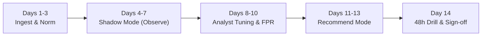

# Ethio-Cyber-Shield (ECS) — Pilot Onboarding & 14-Day Shadow Protocol

> **Purpose**: Standard operating procedure for onboarding financial operators, commercial banks, and fintechs onto Ethio-Cyber-Shield v3.0 without operational disruption.  
> **Mandate**: Enforce safe, zero-impact transition from telemetry ingestion to safe automation via the **14-Day Progressive Shadow Protocol**.

---

## 1. Onboarding Timeline Overview

---

## 2. The 14-Day Progressive Protocol

### Phase 1: Days 1–3 — Ingestion & Schema Normalization
- **Goal**: Establish durable telemetry streaming without activating detection triggers.
- **Actions**:
  1. Provision dedicated tenant partition (`organization_id UUID`).
  2. Deploy ECS Client SDKs (Python, Node.js, or PHP) or configure webhook/syslog collectors.
  3. Stream raw events to Redis Streams. Verify transactional outbox delivery.
  4. Validate event normalization in Data Quality Service (`completeness_score >= 0.95`).
- **Safety Posture**: Response engine disabled (`observe` mode enforced platform-wide).

### Phase 2: Days 4–7 — Shadow Detection Mode (`observe`)
- **Goal**: Evaluate detection rules against live production traffic without firing alerts to operations.
- **Actions**:
  1. Activate rule packs in `shadow` mode (`web_api_rule_pack`, `basic_payment_fraud_pack`, `advanced_ethiopian_fraud_pack`).
  2. Telemetry rules evaluate real-time transactions (USSD velocity, structuring, SIM-swap patterns).
  3. Risk engine calculates feature weights and advisory scores in background.
  4. Track potential False Positive Rates (FPR) without notifying SOC queue.
- **Exit Criteria**: FPR evaluated; zero operational impact on customer transactions.

### Phase 3: Days 8–10 — Analyst Feedback & Rule Tuning
- **Goal**: Fine-tune per-tenant thresholds based on actual banking traffic baselines.
- **Actions**:
  1. Conduct daily feedback review with lead SOC analysts.
  2. Identify high-volume business transactions triggering benign alerts (e.g., corporate payroll batches).
  3. Add legitimate corporate accounts and CIDR blocks to tenant Allowlist.
  4. Adjust rule threshold overrides via `PUT /api/rules/<id>/tenant-override`.
- **Exit Criteria**: False positive rate on high-risk detections reduced to $\le 5\%$.

### Phase 4: Days 11–13 — Recommend Posture & Reversibility Drills
- **Goal**: Transition from shadow mode to human-in-the-loop recommendations.
- **Actions**:
  1. Promote selected playbooks from `observe` to `recommend` mode.
  2. Playbooks generate actionable case recommendations for analysts with SLA milestone timers.
  3. Execute simulated mitigation drills: test temporary account hold and test IP block.
  4. Verify **Rollback Reversibility**: execute `revert` method on connector and confirm state restored.
- **Exit Criteria**: 100% of tested response actions successfully reverted within SLA.

### Phase 5: Day 14 — Statutory Readiness Tabletop Drill & CISO Sign-Off
- **Goal**: Verify incident-readiness under Ethiopian statutory deadlines.
- **Actions**:
  1. Simulate high-severity incident: trigger mock P2P mule cascade.
  2. Verify 48-Hour Statutory Clock activation in East Africa Time (`Africa/Addis_Ababa`, UTC+3).
  3. Auto-generate bilingual EthioCERT submission package (`ECS-IRS-v1.0`).
  4. Cryptographically seal Evidence Vault manifest (triple SHA-256 hash).
  5. Executive briefing: Review executive KPI dashboard (`/api/dashboard/executive`).
  6. CISO and DPO formal sign-off.
- **Exit Criteria**: Pilot successfully graduated to Production Pro or Managed operation.

---

## 3. Pilot Verification Checklist

| Step | Verification Task | Responsible | Passed? |
| :--- | :--- | :--- | :---: |
| 1 | Tenant UUID provisioned with isolated data store | ECS Operations | [ ] |
| 2 | Telemetry stream validated with zero dropped events | Bank Infra Team | [ ] |
| 3 | Corporate payroll accounts added to tenant allowlist | Bank SOC Lead | [ ] |
| 4 | Emergency Kill Switch tested and operational | Security Admin | [ ] |
| 5 | Reversible rollback action verified on test account | Bank SOC Analyst | [ ] |
| 6 | 48-hour EthioCERT bilingual dossier generated & sealed | Lead Analyst | [ ] |
| 7 | Low-bandwidth mode verified on regional branch client | Regional IT Lead | [ ] |
| 8 | Executive metrics verified by CISO | Bank CISO | [ ] |
