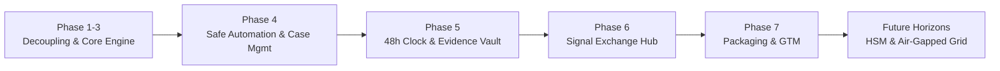

# Ethio-Cyber-Shield (ECS) — Product & Technical Roadmap

> **Platform Version**: 3.0 Independent Defense Architecture  
> **Target Audience**: Ethiopian Commercial Banks, Telecommunications Operators, FinTechs, Microfinance Institutions, and National Critical Infrastructure Operators.

---

## 1. Roadmap Overview & Milestones

The roadmap reflects the transformation of Ethio-Cyber-Shield from a prototype into an independent, explainable, self-hostable cybersecurity detection and incident-readiness platform.

---

## 2. Completed Milestones (v3.0 Release)

### Phases 1–3: Architectural Independence & Foundation (Completed)
- **Multi-Tenancy Core**: Strict schema-level and memory-level isolation using `organization_id UUID NOT NULL`.
- **Durable Event Streaming**: Decoupled ingestion using Redis Streams and transactional outbox.
- **Declarative Detection Engine**: Versioned YAML rule definitions with lifecycle states (`draft`, `backtest`, `shadow`, `live`).
- **Risk Model v2**: Explainable deterministic feature weighting with ML advisory scoring.
- **Client SDKs**: Lightweight client libraries for Python, Node.js, and PHP.

### Phase 4: Safe Response Automation & Case Management (Completed)
- **Progressive Risk Postures**: Four-stage operational modes (`observe` $\to$ `recommend` $\to$ `approve` $\to$ `auto`).
- **Guardrails Engine**: Emergency kill switch, CIDR/account allowlists, rate limits, action cooldowns, and reversible containment connector contracts.
- **Case Management & SLA Tracking**: Time-to-Acknowledge (TTA), Time-to-Contain (TTC), Time-to-Resolve (TTR) dynamic health evaluation (`on_track`, `at_risk`, `breached`).
- **Encrypted Multi-Channel Notifications**: Telegram, SMS, Email, and Webhook dispatchers with PII scrubbing and Addis Ababa quiet hours enforcement.
- **Analyst Feedback Loop**: Explicit feedback capture, false positive rate tracking, and automated rule tuning recommendations.
- **Bilingual Post-Incident Reviews (PIR)**: Amharic and English formal reviews with SHA-256 cryptographic locking.

### Phase 5: Incident Readiness Engine & Evidence Vault (Completed)
- **48-Hour Statutory Clock**: Real-time statutory countdown clock conforming to **INSA Proclamation No. 1426/2026** with 24h, 36h, and 44h progressive escalation milestones.
- **EthioCERT Bilingual Submission Package**: Automated `ECS-IRS-v1.0` dossier generator formatted in Amharic and English.
- **Cryptographic Evidence Vault**: Tamper-evident evidence storage with triple SHA-256 cryptographic sealing, chain-of-custody logging, and one-click audit bundles.
- **Statutory Obligation Register**: Baseline compliance mapping register adhering strictly to Rule #6 (*"supports evidence for"*).

### Phase 6: Privacy-Preserving Community Signal Exchange (Completed)
- **Keyed Hash Anonymization**: Indicator obfuscation using HMAC-SHA256 with institutional salts (`HUB_PEPPER`). Raw PII, account balances, and unmasked identifiers are never shared.
- **FIRST Standards TLP v2.0**: Strict Traffic Light Protocol enforcement (`CLEAR`, `GREEN`, `AMBER`, `RED` strictly local).
- **Anti-Poisoning Corroboration Engine**: Mandates independent corroboration ($N \ge 2$) from distinct financial entities before cross-tenant intelligence is promoted.
- **Hard Safe Automation Rule**: Uncorroborated community signals are barred from auto-blocking (`allow_automated_block: false`).
- **OASIS STIX 2.1 & EthioCERT Advisories**: Full bi-directional STIX 2.1 JSON export and import with INSA threat bulletin ingestion.

### Phase 7: Productization, Packaging & Go-to-Market (Completed)
- **Four Platform Editions**:
  1. `community`: Free, self-hosted, Apache-2.0 open-source defense platform.
  2. `pro`: Commercial edition for licensed financial institutions, equipped with 48h readiness clock, evidence vault, and advanced Ethiopian fraud packs.
  3. `managed`: Turnkey defense operations with dedicated tuning reviews and tabletop drills.
  4. `sector_hub`: Multi-tenant signal exchange hub for banking consortia, EthSwitch, and national CERT authorities.
- **Executive & Operational Metrics**: Real-time MTTD, MTTA, MTTC, MTTR, total ETB volume protected, statutory 48h compliance rate, and noise reduction ratios.
- **Low-Bandwidth Mode**: Ultra-compact JSON telemetry payload (<1 KB) engineered for 2G/3G and VSAT rural bank branches.
- **Multilingual Support (i18n)**: Native cybersecurity terminology in English, Amharic (`አማርኛ`), and Afaan Oromo (`Afaan Oromoo`).
- **Operational Runbooks & Pilot Onboarding**: 14-day shadow mode protocol and complete deployment runbooks.

---

## 3. Future Horizons (v3.1 – v3.5)

| Target Release | Capability Area | Description | Target Operators |
| :--- | :--- | :--- | :--- |
| **v3.1** | **Hardware Security Module (HSM) Integration** | Direct PKCS#11 integration with Thales/SafeNet HSMs for root evidence vault signing and cryptographic key sealing. | EthSwitch, National Clearing House |
| **v3.2** | **Air-Gapped SCADA Appliance** | Offline deployment profile with unidirectional optical data diodes for power generation, railway, and telecom substations. | Ethiopian Electric Power, Ethio Telecom |
| **v3.3** | **Federated Differential Privacy ML** | Cross-tenant ML model parameter aggregation using differential privacy ($\epsilon \le 0.5$) without raw transaction telemetry leaving institutional premises. | Commercial Banking Consortium |
| **v3.4** | **National Telephony Signaling Firewall** | SS7 / Diameter protocol inspection connectors detecting real-time SIM-swap and IMSI-catcher attacks prior to USSD session initiation. | Ethio Telecom, Safaricom Ethiopia |
| **v3.5** | **Automated Regulatory Telemetry Push** | Secure API pipe directly transmitting signed incident readiness packages to INSA EthioCERT upon executive release authorization. | Licensed Financial Operators |

---

## 4. Governance & Contribution Cadence

- **Release Cycles**: Minor releases ship every 6 weeks; critical security patches ship out-of-band within 24 hours.
- **Deprecation Policy**: 6-month notice for API route deprecation with non-breaking backward compatibility.
- **Community Contributions**: Welcome via GitHub pull requests following our [Contribution Guidelines](../CONTRIBUTING.md).
